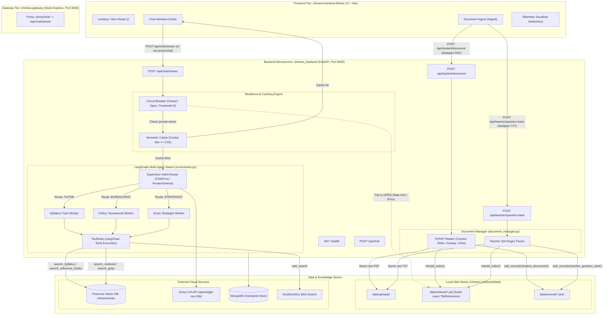

# 🏛️ Chimera AI — Comprehensive Architectural Map & PDF Ingestion Analysis

This document provides a complete architectural map of the **Chimera AI** multi-agent academic swarm ecosystem and delivers a code-level assessment of whether the PDF uploading page is connected for ingesting PDFs and sending them to a Vector Database.

---

## Part 1: System Architectural Map

### 1. High-Level System Overview

The Chimera AI platform is composed of four principal tiers:
1. **Frontend Client Layer (`chimera-frontend`)**: React 19 SPA powered by Vite, Tailwind CSS v4, Framer Motion, and 21st.dev UI components.
2. **API Gateway Layer (`chimera-gateway`)**: Node.js / Express reverse proxy with `http-proxy-middleware` running on port 3000.
3. **Multi-Agent Orchestration & Core Backend (`chimera_backend`)**: Python FastAPI microservice running on port 8000, LangGraph dynamic supervisor swarm, Semantic Caching singleton, and Circuit Breaker fault-tolerance engine.
4. **Knowledge, Retrieval & Storage Layer**:
   - **Vector Database**: Pinecone Cloud Index (`chimera-brain`) with isolated namespaces (`syllabi`, `reference_books`, `rule_books`, `previous_year_qps`, `qb_and_mse`).
   - **Local TF-IDF Search Engine (`offline_retriever.py`)**: Inverted index and document store (`data/indexes/*.pkl`, `data/records/*.json`).
   - **Checkpoint Storage**: MongoDB / In-memory checkpointing (`MongoDBSaver` / `MemorySaver`).
   - **Semantic Cache (`semantic_cache.py`)**: SentenceTransformer embedding store for cosine similarity cache hits (>0.92).

---

### 2. End-to-End Architectural Flow Diagram



---

### 3. Component Deep Dive

| Layer | File / Module | Responsibility |
| :--- | :--- | :--- |
| **Frontend UI** | `chimera-frontend/src/pages/IngestPage.jsx` | Drag-and-drop file ingestion portal for Student PDFs and Teacher Question Banks. |
| **Frontend Chat** | `chimera-frontend/src/pages/ChatPage.jsx` | SSE event streaming consumer with telemetry badging and optional `document_id` binding. |
| **API Gateway** | `chimera-gateway/index.js` | Express proxy re-routing `/proxy/chat` to `http://localhost:8000/api/chat/stream`. |
| **Backend API** | `chimera_backend/server.py` | FastAPI application serving chat streaming (`/api/chat/stream`), document ingestion endpoints, and circuit breaker logic. |
| **Swarm Orchestrator** | `chimera_backend/orchestrator.py` | LangGraph compiled graph orchestrating `supervisor` -> `[tutor, bureaucrat, strategist]` -> `tools` -> response synthesis. |
| **Tools & Cloud Vector Access** | `chimera_backend/tools.py` | Asynchronous retrieval tools querying Pinecone namespaces via `PineconeVectorStore` and `SentenceTransformerRerank`. |
| **Offline Retriever** | `chimera_backend/offline_retriever.py` | Local Scikit-Learn TF-IDF vectorizer and cosine similarity search engine saving to `.pkl` and `.json`. |
| **Document Processing** | `chimera_backend/document_manager.py` | PyPDF chunking and indexing logic for uploaded files. |
| **Offline Cloud Ingestion Script** | `chimera_backend/cloud_ingest.py` | Standalone batch ingestion script that reads local curriculum directories and pushes to Pinecone cloud namespaces. |

---

## Part 2: Detailed Technical Finding on PDF Uploading & Vector DB Ingestion

### Question:
> **"Is the PDF uploading page connected for ingesting PDF and sending it to vector db or not?"**

### Direct Answer:
**PARTIALLY CONNECTED for Ingestion, but NOT CONNECTED to the Pinecone Vector Database.**

Specifically:
1. **The PDF Upload Page IS Connected to the Ingestion API Pipeline:**
   - The React frontend at `/ingest` (`IngestPage.jsx`) successfully sends an HTTP `POST` multipart/form-data request to `${API_BASE_URL}/api/student/document`.
   - The FastAPI backend endpoint in `server.py` receives the file, checks limits (max 20MB, `.pdf` extension), and calls `ingest_pdf(file.filename, content)` in `chimera_backend/document_manager.py`.
   - `document_manager.py` parses the PDF pages using `pypdf.PdfReader`, slices text into chunks of 900 words with 120 words overlap, generates unique UUIDs and a `document_id`, saves the original PDF to `chimera_backend/data/uploads/`, and returns metadata (filename, total pages, chunks count, and `document_id`).

2. **The Ingested PDF is NOT Sent to a Vector Database (Pinecone):**
   - In `chimera_backend/document_manager.py` (lines 85–87):
     ```python
     if not records:
         raise ValueError("No selectable text was found in the PDF.")
     add_records("student_documents", records)
     return {"document_id": document_id, "filename": filename, "pages": len(reader.pages), "chunks": len(records)}
     ```
   - `add_records()` belongs to `chimera_backend/offline_retriever.py`, which is a **local Scikit-Learn TF-IDF sparse matrix index**, **not a dense vector database**.
   - `add_records()` persists raw chunk text and metadata into a local JSON file (`chimera_backend/data/records/student_documents.json`) and fits a `TfidfVectorizer(stop_words="english", ngram_range=(1, 2))` saved to disk via `pickle` (`chimera_backend/data/indexes/student_documents.pkl`).
   - **No call to Pinecone, LlamaIndex `PineconeVectorStore`, or dense embedding models (e.g. HuggingFace `sentence-transformers`) is made during this upload request.**

3. **How Document Ingestion Relates to the Actual Pinecone Vector DB:**
   - The codebase *does* have a Pinecone Cloud Vector DB (`chimera-brain`), and agent tools in `chimera_backend/tools.py` query Pinecone namespaces (`syllabi`, `reference_books`, `rule_books`, `previous_year_qps`).
   - Cloud vector ingestion to Pinecone is implemented in a **separate offline developer script** (`chimera_backend/cloud_ingest.py`), which reads static directories from `./data/*` using LlamaIndex `SimpleDirectoryReader` and pushes them into Pinecone with HuggingFace MiniLM embeddings.
   - However, **`cloud_ingest.py` is never called by `server.py` or `document_manager.py` during runtime user PDF uploads.**

4. **How the Uploaded PDF is Actually Used at Query Time:**
   - When a user copies the returned `document_id` and attaches it in `/chat` (`ChatPage.jsx`), `ChatPage.jsx` sends `{ prompt, thread_id, document_id }` to `POST /api/chat/stream`.
   - In `chimera_backend/server.py`:
     ```python
     if request.document_id:
         context, _ = local_context(prompt, request.document_id)
         effective_prompt = f"Answer using this uploaded PDF context:\n{context}\n\nQuestion: {prompt}"
     ```
   - `local_context()` executes `offline_retriever.search("student_documents", prompt, filters={"document_id": document_id})`.
   - It performs **TF-IDF cosine similarity over the local `.pkl` matrix** to extract matching text chunks, and prepends those chunks as raw prompt context before delegating to LangGraph!
   - Thus, the PDF retrieval path operates entirely through the **local offline TF-IDF engine**, completely bypassing the Pinecone Vector DB.

5. **Frontend Fallback Mocking When Backend Is Unreachable:**
   - In `chimera-frontend/src/pages/IngestPage.jsx` (lines 58–66):
     ```javascript
     } catch (err) {
       console.warn("Backend offline; using local mock ingestion:", err);
       const mockId = `doc_${Math.random().toString(36).substring(2, 9)}`;
       setStudentResult({
         document_id: mockId,
         filename: studentFile.name,
         pages: 14,
         chunks: 42,
       });
     }
     ```
   - If the backend is not running or network fails, the frontend simulates ingestion by returning mock stats and a fake random `document_id` without communicating with any backend or database.

---

### Summary Checklist of PDF Upload & Vector DB Status

| Pipeline Stage | Implementation Status | Technical Mechanism |
| :--- | :--- | :--- |
| **Frontend UI Upload Form** | ✅ Connected | Drag-and-drop input in `IngestPage.jsx` supporting `.pdf` files. |
| **Frontend to Backend API Call** | ✅ Connected | `fetch("${API_BASE_URL}/api/student/document", { method: "POST", body: formData })`. |
| **Backend File Ingestion Route** | ✅ Connected | FastAPI `@app.post("/api/student/document")` validates file and passes bytes. |
| **PDF Text Extraction & Chunking**| ✅ Connected | `pypdf.PdfReader` chunks text (900 words, 120 word overlap). |
| **Sent to Pinecone Vector DB?** | ❌ **NOT Connected** | Does NOT call Pinecone. It calls `offline_retriever.add_records()`. |
| **Underlying Indexing Type** | ⚠️ Local TF-IDF | Scikit-Learn `TfidfVectorizer` dumped to local `.pkl` and `.json`. |
| **Attached Document Querying** | ✅ Connected (via TF-IDF) | `ChatPage.jsx` passes `document_id` -> `offline_search` -> prompt context injection. |
| **Cloud Vector DB Ingestion** | ⚠️ Offline Script Only | Exists solely in `cloud_ingest.py` for pre-loading static course folders. |
