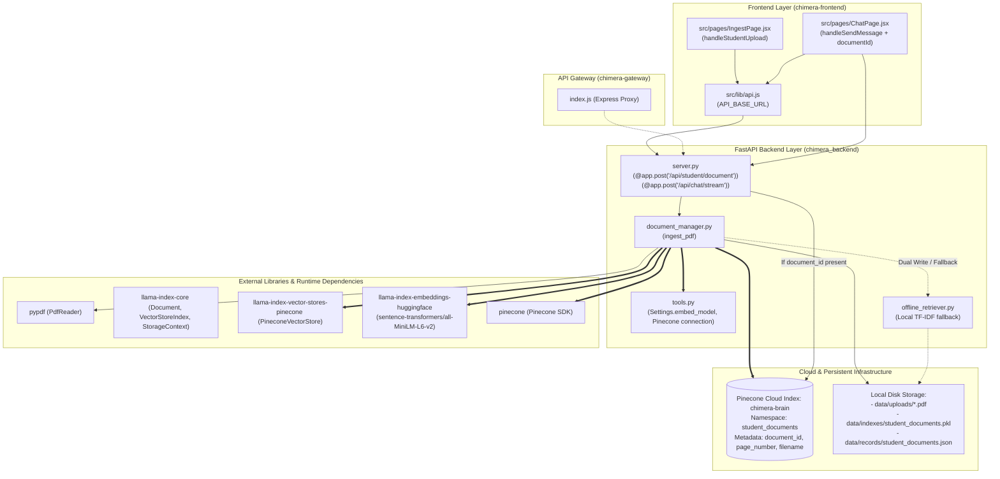

# 🗺️ PDF Ingestion to Vector DB: Dependency Map & Implementation Plan

This document establishes the **Dependency Map** and step-by-step **Implementation Plan** to connect the PDF upload pipeline directly to the Pinecone Vector Database (`chimera-brain`), replacing/supplementing the current local-only TF-IDF offline index.

---

## Part 1: Dependency Map

### 1. Component & Module Interaction Graph



---

### 2. Dependency Matrix

| Category | Dependency / Asset | Current Role | Target Role in Vector Ingestion |
| :--- | :--- | :--- | :--- |
| **Frontend UI** | `IngestPage.jsx` | Submits `FormData(file)` to `/api/student/document`, displays returned `document_id`. | Unchanged; UI already receives `document_id` and has copy/chat shortcuts. |
| **Backend Route** | `server.py` | Receives multipart upload; handles `document_id` retrieval. | Update `local_context` to query Pinecone `student_documents` namespace first with metadata filtering on `document_id`. |
| **Ingestion Engine**| `document_manager.py` | Extracts text with `pypdf`, calls `offline_retriever.add_records()`. | Transform into hybrid pipeline: generate text chunks -> instantiate `PineconeVectorStore(namespace="student_documents")` -> embed & upsert to Pinecone index with metadata. |
| **Cloud Vector DB**| Pinecone (`chimera-brain`)| Used by static tools (`syllabi`, `rule_books`, etc.) in `tools.py`. | Add dedicated dynamic namespace `student_documents` where uploaded chunks are indexed with `{ document_id, filename, page_number }`. |
| **Embedding Engine**| `HuggingFaceEmbedding` | Initialized in `tools.py` (`all-MiniLM-L6-v2`, 384 dimensions). | Reuse shared embedding model from `tools.py` or `Settings.embed_model` to avoid redundant GPU/CPU memory overhead. |
| **Local Fallback** | `offline_retriever.py`| Primary search (TF-IDF). | Retain as offline fallback if Pinecone API key is missing or network fails. |

---

## Part 2: Implementation Plan

### Phase 1: Environment & Cloud Vector Store Setup
1. **Pinecone Index Verification & Namespace Contract:**
   - Confirm index `chimera-brain` supports dynamic metadata filtering on `document_id`.
   - Standardize target namespace name: `student_documents`.
   - Define metadata schema:
     ```json
     {
       "document_id": "uuid-string",
       "filename": "operating_systems_notes.pdf",
       "page_number": 1,
       "source_type": "student_pdf"
     }
     ```

### Phase 2: Ingestion Logic Refactoring (`document_manager.py`)
1. **Implement Pinecone Vector Ingestion:**
   - Import `PineconeVectorStore`, `StorageContext`, `VectorStoreIndex`, and `Document` from `llama_index`.
   - Reuse embedding configuration from `chimera_backend.tools` (`Settings.embed_model`).
   - Create helper `ingest_pdf_to_pinecone(document_id: str, filename: str, records: list[dict])`:
     - Convert parsed chunks into LlamaIndex `Document` instances with text and metadata (`document_id`, `filename`, `page_number`).
     - Initialize `PineconeVectorStore(pinecone_index=pinecone_index, namespace="student_documents")`.
     - Ingest documents in batches (e.g. 50 chunks per batch) into `chimera-brain`.
2. **Implement Dual-Write Fault Tolerance:**
   - Wrap Pinecone upload in a `try...except` block:
     - On success: Write to Pinecone, and optionally update local TF-IDF cache.
     - On Pinecone error (e.g. rate limit, invalid API key, offline): Log warning, fallback cleanly to `offline_retriever.add_records()`, and flag `storage_mode: "offline_tfidf"`.
   - Update return JSON payload:
     ```json
     {
       "document_id": "...",
       "filename": "...",
       "pages": 14,
       "chunks": 42,
       "vector_store": "pinecone",
       "namespace": "student_documents"
     }
     ```

### Phase 3: Query & Retrieval Pipeline Updates (`server.py`)
1. **Dynamic Vector Document Retriever:**
   - Create a dedicated retriever function in `tools.py` or `server.py`:
     ```python
     async def retrieve_student_document_context(prompt: str, document_id: str) -> tuple[str, str]:
     ```
   - Connect to Pinecone namespace `student_documents` with an exact metadata filter:
     `MetadataFilters(filters=[ExactMatchFilter(key="document_id", value=document_id)])`.
   - Query top-k matching nodes (e.g., top 4 chunks), re-rank using `GLOBAL_RERANKER`, and format context string.
2. **Update Server Chat Endpoints:**
   - In `server.py`, update `chat_endpoint` and `stream_chat_endpoint`:
     - If `request.document_id` is supplied:
       - Attempt Pinecone vector search for that `document_id`.
       - If Pinecone returns matches, format context and mark mode as `pinecone vector search`.
       - If Pinecone fails or returns empty, fall back to `offline_retriever.search("student_documents", prompt, filters={"document_id": document_id})`.

### Phase 4: Frontend Transparency (`chimera-frontend`)
1. **Enhance Ingestion Feedback in `IngestPage.jsx`:**
   - Display a badge indicating whether the document was indexed in `"Pinecone Vector Cloud"` or `"Local TF-IDF Fallback"`.
2. **Telemetry Node Activation in `TelemetryPage.jsx` / `ChatPage.jsx`:**
   - When a document-filtered query streams, display status badge: `"Retrieving context from Pinecone namespace [student_documents]..."`.

---

## Part 3: Verification & Test Strategy
1. **Unit Test Ingestion Function:**
   - Verify that parsing a mock sample PDF produces valid LlamaIndex documents with required metadata keys.
2. **Mocked Pinecone Test:**
   - Test `ingest_pdf` with mock Pinecone responses to confirm dual-write and graceful fallback behaviors.
3. **End-to-End Query Verification:**
   - Ingest a PDF, capture returned `document_id`, submit a chat query attaching `document_id`, and verify that retrieved text chunks match the PDF content via vector similarity.
