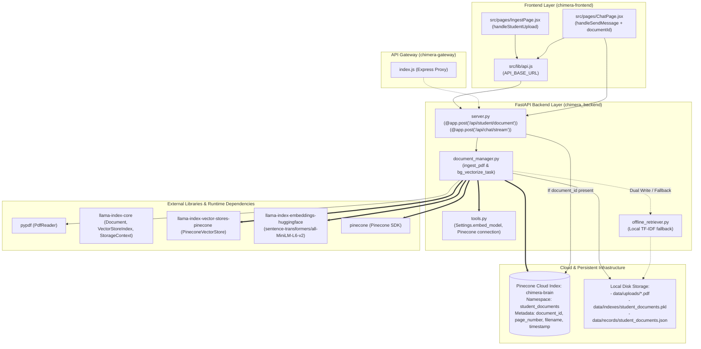

# 🗺️ PDF Ingestion to Vector DB: Dependency Map & Hardened Implementation Plan

This document establishes the **Dependency Map** and step-by-step **Implementation Plan** to connect the PDF upload pipeline directly to the Pinecone Vector Database (`chimera-brain`), including concrete, production-grade resolutions for latency, multi-agent integration, quota limits, and fallback resilience.

---

## Part 1: Dependency Map

### 1. Component & Module Interaction Graph



---

## Part 2: Concrete Resolutions to Key Plan Issues

### Issue 1: Gateway Timeouts vs. Synchronous CPU Embedding Latency
* **Root Cause:** Generating 50–150 dense embeddings using `sentence-transformers/all-MiniLM-L6-v2` on CPU and uploading to Pinecone takes 15–45 seconds, which risks tripping 30s HTTP gateway timeouts in reverse proxies (e.g. Railway, Express gateway, Vercel).
* **Specific Fix (Two-Stage Instant Index + Background Upsert):**
  1. **Immediate Local Index (Stage 1, <300ms):**
     - Parse PDF text using `pypdf.PdfReader` and extract text chunks synchronously.
     - Immediately persist text records to `offline_retriever` (local JSON & TF-IDF index) so the document is **instantly queryable** without blocking.
     - Return HTTP 200 immediately to the client with:
       ```json
       {
         "document_id": "doc_xyz123",
         "filename": "lecture_01.pdf",
         "pages": 14,
         "chunks": 42,
         "status": "ready",
         "vector_indexing": "in_progress"
       }
       ```
  2. **Background Vector Upsert (Stage 2 via FastAPI `BackgroundTasks`):**
     - Dispatch an asynchronous background task `background_upsert_pdf_to_pinecone(document_id, filename, chunks)` using FastAPI's `BackgroundTasks`.
     - Process in batches of 25 chunks with a 0.5s pause to respect free-tier Pinecone rate limits.
     - Once complete, mark document state as `vectorized` in metadata.

---

### Issue 2: Multi-Agent Swarm Routing vs. Static Prompt Injection
* **Root Cause:** In the current `server.py`, if a `document_id` is passed, it directly injects raw context into the prompt:
  ```python
  effective_prompt = f"Answer using this uploaded PDF context:\n{context}\n\nQuestion: {prompt}"
  ```
  This bypasses the dynamic multi-agent supervisor and prevents tools from doing iterative research.
* **Specific Fix (Hybrid Scoped Context + Dedicated Agent Tool):**
  1. **Add a Dedicated LangChain Retrieval Tool in `tools.py`:**
     ```python
     class DocumentSearchSchema(BaseModel):
         query: str = Field(description="The specific search query to look up inside the attached PDF.")
         document_id: str = Field(description="The unique UUID of the uploaded document.")

     @tool(args_schema=DocumentSearchSchema)
     async def search_uploaded_document(query: str, document_id: str) -> str:
         """Searches through the student's uploaded PDF notes or syllabus for specific questions."""
         return await retrieve_document_context(query, document_id)
     ```
  2. **Bind Tool to the Tutor Agent:**
     - Add `search_uploaded_document` to `tutor_tools` in `chimera_backend/orchestrator.py`.
     - When the `supervisor` routes a syllabus or concept question with an attached `document_id`, the **Tutor Agent** dynamically calls `search_uploaded_document(query, document_id)`.
  3. **Preserve Fallback for Direct Queries:**
     - If the user provides a `document_id` but the supervisor routes to another worker (or for short-circuit caching), provide top 2 matching chunks as system context so ground truth is always preserved.

---

### Issue 3: Pinecone Free-Tier Quota & Vector Lifecycle Management
* **Root Cause:** Free-tier Pinecone starter pods limit vector count and index count. Unbounded PDF uploads could exhaust storage quotas.
* **Specific Fix (Capping & Least-Recently-Used Eviction):**
  1. **Upload Size & Chunk Caps:**
     - Enforce `MAX_PDF_PAGES = 30` and `MAX_CHUNKS_PER_DOC = 60`. If a PDF exceeds 30 pages, extract the first 30 pages and log a user warning.
  2. **Metadata Timestamping & TTL Pruning:**
     - Attach `created_at` (UNIX epoch timestamp) to every Pinecone vector's metadata.
     - Implement a weekly or startup prune check `cleanup_expired_vectors(namespace="student_documents", max_age_days=14)` that queries Pinecone metadata and calls `pinecone_index.delete(filter={"created_at": {"$lt": cutoff}})` to clean up abandoned documents.

---

### Issue 4: Pinecone Credential Validation & Dual-Write Fault Tolerance
* **Root Cause:** If `PINECONE_API_KEY` is not configured, expired, or network unreachable, PDF uploads should not crash with a 500 internal server error.
* **Specific Fix (Graceful Circuit-Guarded Dual Write):**
  1. **Credential Probing:**
     - On module load, check `bool(os.getenv("PINECONE_API_KEY"))`. If missing, log `[VectorDB] Pinecone not configured. Operating in local TF-IDF mode.`
  2. **Resilient Ingestion Wrapper in `document_manager.py`:**
     ```python
     def ingest_pdf(filename: str, content: bytes, background_tasks: BackgroundTasks) -> dict:
         document_id = str(uuid.uuid4())
         # 1. Parse & generate chunks
         chunks, pages = extract_pdf_chunks(content)

         # 2. Synchronous local TF-IDF write (guaranteed <300ms)
         add_records("student_documents", chunks_to_records(document_id, filename, chunks))

         # 3. Queue Pinecone background task if credentials exist
         if os.getenv("PINECONE_API_KEY"):
             background_tasks.add_task(
                 async_upsert_to_pinecone,
                 document_id=document_id,
                 filename=filename,
                 chunks=chunks
             )

         return {
             "document_id": document_id,
             "filename": filename,
             "pages": pages,
             "chunks": len(chunks),
             "storage_mode": "hybrid_pinecone" if os.getenv("PINECONE_API_KEY") else "local_tfidf"
         }
     ```
  3. **Resilient Retrieval Fallback in `server.py`:**
     - When querying `document_id`:
       ```python
       async def retrieve_document_context(query: str, document_id: str) -> tuple[str, str]:
           # Try Pinecone first
           if os.getenv("PINECONE_API_KEY"):
               try:
                   results = await search_pinecone_document(query, document_id)
                   if results:
                       return results, "Pinecone Vector DB"
               except Exception as err:
                   print(f"⚠️ Pinecone query failed ({err}); switching to local TF-IDF.")

           # Offline TF-IDF fallback
           matches = offline_search("student_documents", query, filters={"document_id": document_id})
           return format_matches(matches), "Offline TF-IDF"
       ```

---

## Part 3: Step-by-Step Code Changes Required

| Step | Target File | Specific Code Action |
| :---: | :--- | :--- |
| **1** | `chimera_backend/document_manager.py` | Add `async_upsert_to_pinecone()`, integrate `BackgroundTasks` parameter into `ingest_pdf()`, add chunk cap (`max 60`). |
| **2** | `chimera_backend/server.py` | Update `@app.post("/api/student/document")` to accept `background_tasks: BackgroundTasks`; update `local_context()` to query Pinecone `student_documents` with TF-IDF fallback. |
| **3** | `chimera_backend/tools.py` | Export `search_uploaded_document` tool with `DocumentSearchSchema` metadata filter on `document_id`. |
| **4** | `chimera_backend/orchestrator.py` | Add `search_uploaded_document` to `tutor_worker` tool bindings. |
| **5** | `chimera-frontend/src/pages/IngestPage.jsx` | Display `storage_mode` indicator in the completion card (`Pinecone Cloud` vs `Local Index`). |
